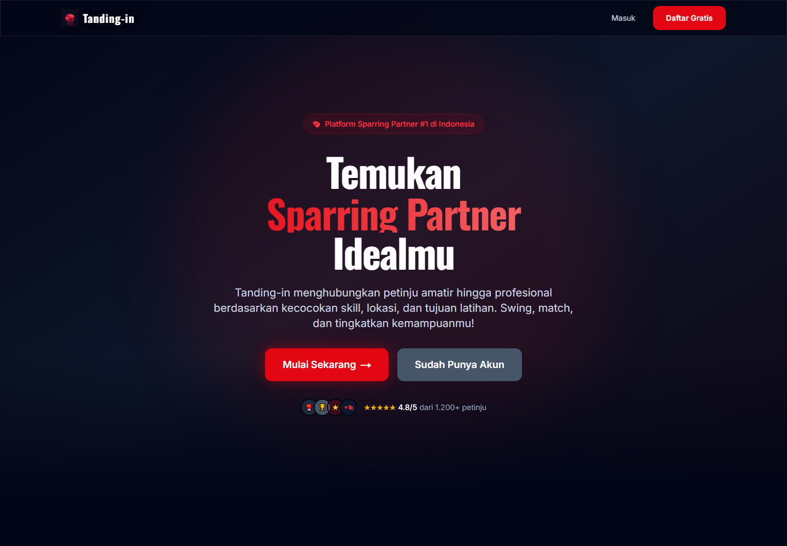
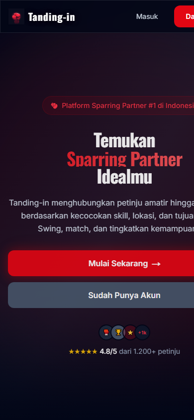
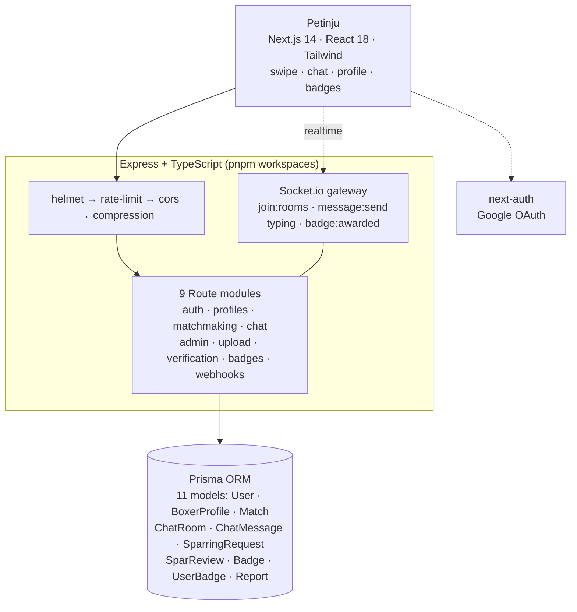

# Tanding-in — Cari Sparring Partner Tinju, Sesimpel Aplikasi Dating

**Swipe cari partner sparring: kecocokan skill, jarak lokasi, tujuan latihan.**

---

## Tampilan

### Desktop

### Mobile

---

## Masalahnya

- Petinju amatir cari sparring lewat **grup WhatsApp/Instagram** — info Lawas, tidak bisa filter level, sering tidak nyambung jadwalnya
- Sparring dengan lawan yang **terlalu jauh beda skill** = bahaya, bukan latihan
- Gym berbeda kota butuh cara **terstandar** untuk membuat kesepakatan latihan silang

## Tanding-in

Platform matchmaking sparring tinju: lengkapi profil boksing (kelas, record, gaya, target latihan) → **swipe kandidat** berdasarkan kecocokan skill + radius lokasi → chat realtime → ajukan **spar request** → setelah sesi, saling review.

### Fitur

- **Swipe matchmaking** — kartu kandidat dengan compatibility ring (conic gradient), undo (H/L/U keyboard), animasi Framer Motion
- **Filter radius + kecocokan** — `maxRadius` & `minCompatibility` di API kandidat
- **Chat realtime (Socket.io)** — typing indicator 3 dots, mark-as-read, badge notifikasi (cache Map)
- **Spar request lifecycle** — ajukan dari chat → setujui → review pasca-sesi
- **Sistem badge** — 6 badge, event `badge:awarded` realtime + webhook server-to-server
- **Auth ganda** — JWT email/password (validasi kuat 8+lower+upper+symbol) + **Google OAuth** via next-auth; verifikasi email
- **Safety** — SafetyGuidelinesModal di chat, sistem report, admin panel (stats, users, reports)
- **Branding tuntas** — merah sarung tangan `#E30613`, font Oswald, glove logo + favicon lengkap (16→512 + manifest), branded loading screen
- **Mobile-first terverifikasi** — 320/375/768px, bottom nav safe-area 44px

---

## Arsitektur

- **Stack:** Node.js + Express 4.19 · Prisma 5.22 (SQLite dev / PostgreSQL prod, 11 models) · Socket.io 4.8 · Next.js 14.2 + React 18 · Tailwind 3.4 · Framer Motion 11 · next-auth 4.24 · Swagger UI (`/api-docs`)
- **Keamanan:** `JWT_SECRET` wajib tanpa default, rate-limit 100/15 menit, helmet CSP, ownership check, upload validation
- **Kualitas:** backend `tsc` 0 error + frontend `next build` lolos (15 pages) per 2026-08-23

---

## English

**Tanding-in** finds boxing sparring partners the way a dating app finds matches: skill level, distance, and training goal are the filters.

It solves the practical problem of finding someone at your level, near you, who wants the same kind of session.

The source code is not published; this repository documents the product.

---

## Tentang Source Code

Repository ini adalah **showcase** — dokumentasi produk, bukan kode sumber.
Source code Tanding-in tidak dipublikasikan dan semua hak dilindungi. Lihat [`LICENSE`](LICENSE).

> Demo, kolaborasi, atau lisensi? Hubungi [Kandar Lubis](https://github.com/kandarlubis31).

---

© 2026 Kandar Lubis — All Rights Reserved.
